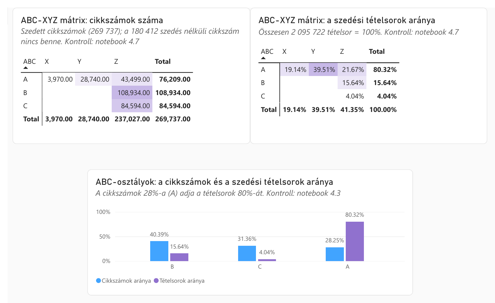
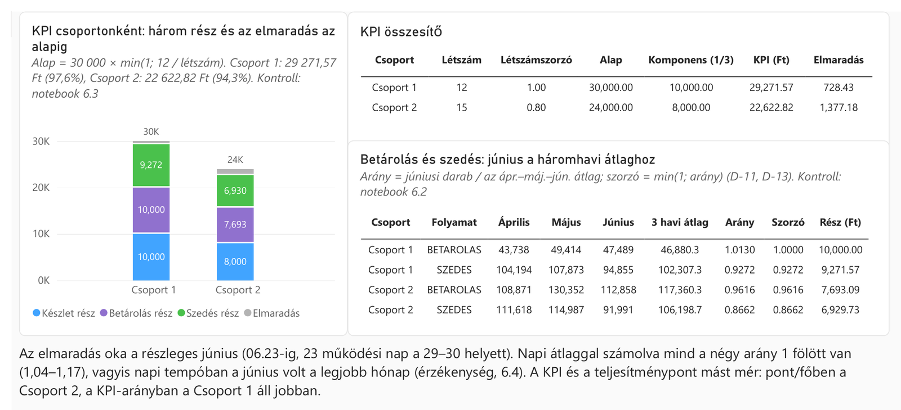
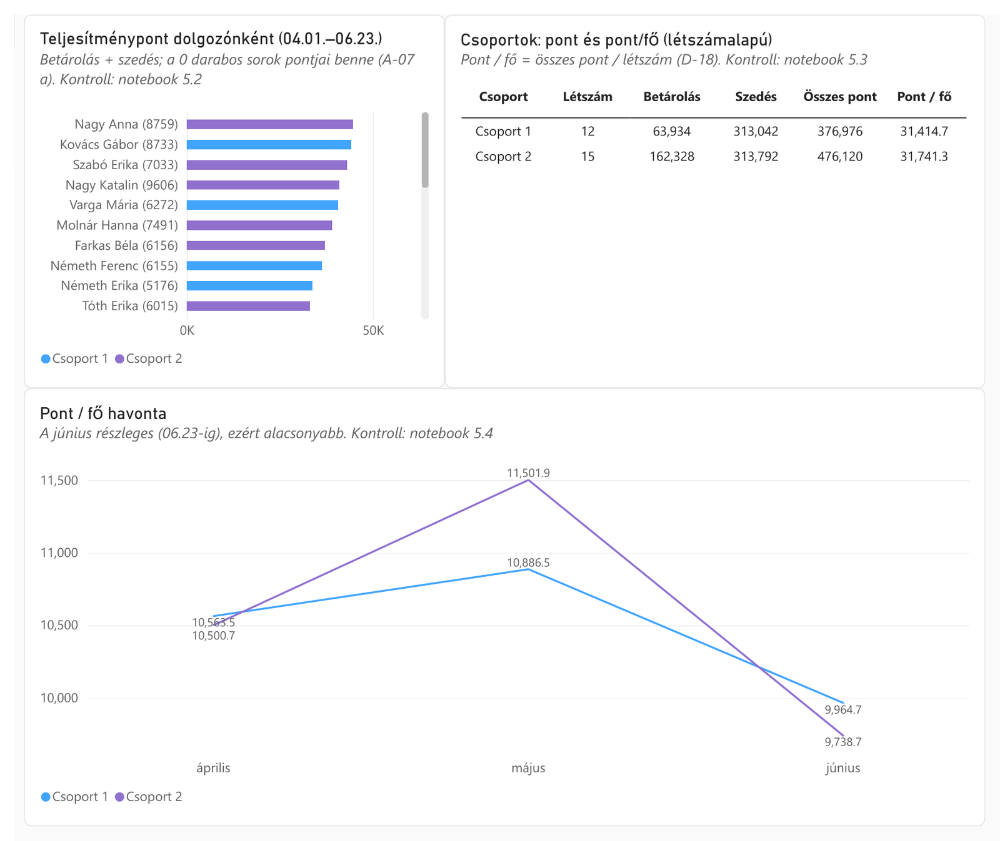
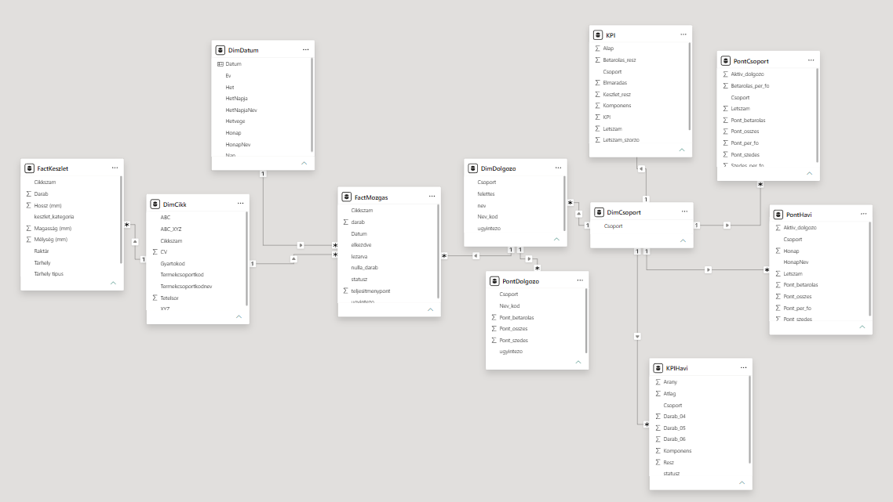

# Raktári működés elemzése

Három hónap raktári működésének (betárolás, szedés, készlet) teljes elemzése, próbafeladatként. Adattisztítás és csillagséma-adatmodell Pythonban, ABC–XYZ elemzés, létszámalapú teljesítménypont, KPI-rendszer, valamint Power BI-riport, amely minden fő eredményt DAX-szal is visszaellenőriz.

> **English version:** [README.md](README.md)
>
> **Miért magyar a projekt?** A feladatkiírás, az adatok és az összes attribútum magyar volt, magyar közönségnek szólt, ezért a notebook, a riport és a dokumentáció is magyarul készült. A programozást, az SQL-t és a Power BI-t egyébként főként angol nyelvű anyagokból tanultam és gyakoroltam (magyar kurzusok mellett), és tudom, hogy a kódolás és az adatelemzés munkanyelve többnyire az angol. Az angol README áttekintést ad a nem magyar olvasóknak.

## Röviden

| | |
|---|---|
| **Adatok** | Kb. 3,85 millió sor 8 Excel-munkalapon (242 MB): létszám, betárolási és szedési tételek, tárhelyek tartalma; 2026.04.01.–06.23. |
| **Eszközök** | Python 3.14 (pandas 3, pyarrow), Jupyter a VS Code-ban, Power BI Desktop (Power Query, DAX) |
| **Eredmények** | [Jupyter notebook](05_Notebook/raktari_elemzes.ipynb) (76 cella, kimenetekkel), Power BI-riport (5 oldal), [prezentáció](04_Dokumentacio/prezentacio.pdf) (21 dia), [döntésnapló](04_Dokumentacio/dontesnaplo.md) |
| **Ellenőrzés** | A sorok száma, a pontok és a KPI a notebookban és a Power BI-ban (DAX) is elkészült: minden eltérés 0,00 |

## A feladat

A feladat egy kitalált alkatrész-logisztikai vállalat két raktári folyamatát vizsgálja: a **betárolást** (a beérkezett áru eltárolása) és a **szedést** (a szedésre ütemezett mennyiségek teljesítése). Az adatok több operatív rendszerből származnak, ezért adattisztítás és további dimenziótáblák kellenek.

1. **Adatmodell:** minden készletmozgás egyértelműen kapcsolódjon a végrehajtó dolgozóhoz, a cikkszám törzsadataihoz és a dátumhoz. A modellt és a kapcsolati logikát be kell mutatni és indokolni.
2. **ABC–XYZ elemzés** a szedési adatok alapján (a határokat szabadon lehet megválasztani), valamint a csapattagok **létszámalapú teljesítménypontjainak** bemutatása.
3. **KPI-rendszer:** 30 000 Ft-os alap, amely 12 fő fölötti csoportlétszámnál arányosan csökken, és három egyenlő részre oszlik: tárhely, betárolás, szedés. A betárolási és a szedési rész az utolsó hónapot a háromhavi átlaghoz méri; ha az utolsó hónap elmarad, csak a rész arányos hányada jár.

## A folyamat


Minden számítás egyszer, a notebookban készül; a Power BI az eredménytáblákat tölti be, a pontokat és a KPI-t pedig DAX-ban függetlenül újraszámolja ellenőrzésként.

| Notebook-szakasz | Mit csinál |
|---|---|
| 1–2. Betöltés és tisztítás | Betölti a CSV-ket, a sorok számát és az összegeket a forráshoz méri, törli az 56 109 teljesen azonos sort és a 9 lezáratlan sort, beállítja a típusokat, jelöli a 0 darabos szedéseket |
| 3. Adatmodell | Csillagséma: egy mozgás-ténytábla mindkét folyamatra (2 957 772 sor), készlet-ténytábla (834 925 sor), dolgozó-, cikk- és dátumdimenzió; ellenőrzi, hogy minden mozgás mindhárom dimenzióhoz kapcsolódik |
| 4. ABC–XYZ | ABC a szedési tételsorok száma alapján (80 / 15 / 5%), XYZ a heti tételsorszám relatív szórásával (X ≤ 0,5, Y ≤ 1,0, Z > 1,0) |
| 5. Teljesítménypont | Pontok dolgozónként és csoportonként egy főre, havi bontás |
| 6. KPI | KPI csoportonként a feladat felépítése szerint, érzékenységvizsgálattal |
| 7. Export | 10 Parquet-fájl a Power BI-nak, visszaolvasással ellenőrizve |

## Fő eredmények

**ABC–XYZ.** 269 737 cikkszámot szedtek 2 095 722 tételsorban. Az A osztály (legalább 6 tételsor) a cikkszámok 28,3%-a, de a tételsorok 80,3%-a. Az AX- és AY-cikkszámok (32 710, a cikkszámok 12,1%-a) adják a tételsorok 58,6%-át, kiszámítható heti igénnyel, így a feltöltésük rendszeres ütemben tervezhető.

**Készlet.** Az A-cikkszámoknál van a készletdarab 71,5%-a. 235 528 tárhely–cikkszám pár (28,2%) olyan cikket tárol, amelyet a három hónap alatt egyszer sem szedtek: ez felülvizsgálati lista, nem selejtezési javaslat.

**Teljesítménypont.** A Csoport 1 (12 fő) 376 976 pontot szerzett, egy főre 31 414,7-et; a Csoport 2 (15 fő) 476 120 pontot, egy főre 31 741,3-at.

**KPI.**

| Csoport | Létszám | Alap | Tárhely | Betárolás | Szedés | KPI |
|---|---|---|---|---|---|---|
| Csoport 1 | 12 | 30 000 | 10 000 | 10 000 (arány 1,013 → 1-re korlátozva) | 9 271,57 (0,927) | **29 271,57 Ft** (97,6%) |
| Csoport 2 | 15 | 24 000 | 8 000 | 7 693,09 (0,962) | 6 929,73 (0,866) | **22 622,82 Ft** (94,3%) |

Az elmaradás oka a részleges utolsó hónap: a június csak 23 napos. Napi átlaggal mind a négy arány 1 fölött van (1,039–1,174), így mindkét csoport a teljes alapot kapná. A hivatalos számítás a feladatkiíró kérésére a nyers havi összegekkel készült; a napi átlagos változat érzékenységvizsgálatként szerepel. A pont és a KPI mást mér: egy főre jutó pontban a Csoport 2, a KPI-arányokban a Csoport 1 áll jobban.

| ABC–XYZ | KPI |
|---|---|
|  |  |
| **Teljesítménypont** | **Adatmodell** |
|  |  |

A riport mind az öt oldala: [powerbi_oldalak.pdf](04_Dokumentacio/powerbi_oldalak.pdf).

## Döntések és adatminőség

Minden döntés a mérlegelt lehetőségekkel és az indoklással együtt a [döntésnaplóban](04_Dokumentacio/dontesnaplo.md) szerepel; a notebook D-xx és A-xx azonosítókkal hivatkozik rá. Néhány példa:

- **Teljesen azonos sorok (D-04):** 56 109 sor minden mezőben, másodpercre egyezett, és nem volt olyan azonosító, amely megkülönböztette volna őket, ezért mindegyikből egy példány maradt.
- **0 darabos szedések (D-06):** 45 408 szedési sorban 0 a darab, mégis kaptak pontot. A darabalapú mutatókban és a pontokban bent maradnak, a tételsor-alapú ABC-ből kimaradnak.
- **Rendszerfelhasználó (D-07):** az „1”-es kód 223 306 szedési sort könyvelt 0 másodperces időtartammal. „Rendszer” jelölést kapott: az ABC–XYZ-ben bent marad (valós kereslet), a dolgozói kimutatásokban nem szerepel.
- **Dolgozók (D-09):** két-két dolgozónak azonos a neve, de eltér a kódja, ezért a kulcs az ügyintézőkód.
- **Egy ténytábla (D-02):** a betárolás és a szedés oszlopai azonosak, így egy mozgástábla szolgálja ki mindkettőt a státuszoszloppal; minden kapcsolat sok-az-egyhez, egyirányú szűréssel (D-28).
- **Részleges június (D-12):** a kérés szerint nyers összeggel, a napi átlagos változat érzékenységvizsgálatként.

## A repó felépítése

```
├── D01_excel_to_csv.py        Excel → 4 CSV-fájl, kontrollszámokkal
├── requirements.txt
├── 01_Forras/                 a forrás-Excel (nincs a repóban, lásd a benne lévő README-t)
├── 03_PowerBI/
│   ├── raktari_elemzes.pbit   Power BI-sablon (modell, DAX, vizuálok; adat nélkül)
│   └── dax_mertekek.md        az összes DAX-mérték szövegként
├── 04_Dokumentacio/
│   ├── dontesnaplo.md         döntésnapló, adatminőségi napló, kontrollszámok
│   ├── prezentacio.pdf        a prezentáció (21 dia)
│   ├── powerbi_oldalak.pdf    a riport öt oldala
│   └── kepek/                 a README képei
└── 05_Notebook/
    └── raktari_elemzes.ipynb  a teljes elemzés, kimenetekkel
```

## Futtatás

A forrásadat nincs a repóban (lásd [01_Forras/README.md](01_Forras/README.md)), ezért a notebook kimenetei és a riport képei az eredeti futtatás eredményét mutatják. Ha a forrásfájl a helyén van:

```
pip install -r requirements.txt
python D01_excel_to_csv.py
```

Ezután a `05_Notebook/raktari_elemzes.ipynb` összes cellája futtatható; a notebook a saját mappájához képest keresi az útvonalakat, és 10 Parquet-fájlt ír a `06_Kimenet` mappába. Végül a `03_PowerBI/raktari_elemzes.pbit` megnyitásakor a `KimenetMappa` paraméterbe a saját `06_Kimenet` mappa teljes útvonala kerül, záró `\`-rel.

## Szerző

Balogh Marcell · [GitHub](https://github.com/marcellbalogh-git) · [LinkedIn](https://www.linkedin.com/in/baloghmarcell/) · [marcellbalogh.srs@gmail.com](mailto:marcellbalogh.srs@gmail.com)

**AI-asszisztens:** a projekt egy AI-asszisztens (Claude, Anthropic) segítségével készült: kódot javasolt, fogalmakat magyarázott, és segített a dokumentáció megírásában. A javasolt kódot soronként végigvettem és értelmeztem, és csak akkor léptem tovább, amikor értettem, mit csinál. Minden lépést magam futtattam, az eredményeket kontrollszámokkal ellenőriztem, és a döntésnaplóban rögzített elemzési döntéseket én hoztam meg.
