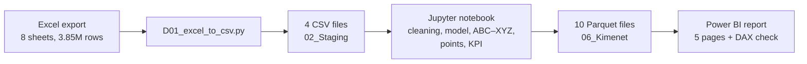

# Warehouse Operations Analysis

End-to-end analysis of three months of warehouse operations (put-away, picking and storage), prepared as a recruitment case study. Data cleaning and a star-schema data model in Python, ABC–XYZ classification, headcount-based performance points, a KPI system, and a Power BI report that reconciles every key result with DAX.

> **Magyar változat:** [README.hu.md](README.hu.md)
>
> **Why is the project in Hungarian?** The task description, the dataset and all of its attributes were in Hungarian, written for a Hungarian audience, so the notebook, the report and the documentation are in Hungarian as well. That said, I learned and practised programming, SQL and Power BI mostly from English-language material (alongside some Hungarian courses), and I am well aware that English is the working language of coding and data analysis. This README gives an English overview.

## At a glance

| | |
|---|---|
| **Data** | About 3.85 million rows in 8 Excel sheets (242 MB): headcount, put-away and picking transactions, storage-location contents; 1 April – 23 June 2026 |
| **Tools** | Python 3.14 (pandas 3, pyarrow), Jupyter in VS Code, Power BI Desktop (Power Query, DAX) |
| **Deliverables** | [Jupyter notebook](05_Notebook/raktari_elemzes.ipynb) (76 cells, outputs included), Power BI report (5 pages), [presentation](04_Dokumentacio/prezentacio.pdf) (21 slides), [decision log](04_Dokumentacio/dontesnaplo.md) |
| **Quality check** | Row counts, points and KPI values are reconciled between the notebook and Power BI (DAX): every difference is 0.00 |

## The task

The case describes a fictional auto-parts logistics company that wants to analyse two warehouse processes: **put-away** (storing incoming goods) and **picking** (fulfilling scheduled quantities). The data come from several operational systems, so cleaning and additional dimension tables are needed.

1. **Data model:** every stock movement must link unambiguously to the employee who performed it, to the item master data and to the calendar. The model and the chosen relationship logic have to be presented and justified.
2. **ABC–XYZ analysis** of items based on picking (thresholds are free to choose), and a visual of the **headcount-based performance points** earned by team members.
3. **KPI system:** a base of 30,000 HUF, reduced proportionally when a group has more than 12 members, split into three equal components: storage, put-away and picking. The put-away and picking components compare the last month with the three-month average; if the last month falls short, only a proportional part of the component is paid.

## Pipeline



All calculations are done once, in the notebook; Power BI loads the result tables and recalculates points and KPI in DAX as an independent check.

| Notebook section | What it does |
|---|---|
| 1–2. Loading and cleaning | Loads the CSVs, checks row counts and totals against the source, removes 56,109 exact duplicates and 9 unclosed rows, sets data types, flags zero-quantity picks |
| 3. Data model | Star schema: one movement fact table for both processes (2,957,772 rows), a stock fact table (834,925 rows), employee, item and date dimensions; checks that every movement links to all three |
| 4. ABC–XYZ | ABC by number of picking order lines (80 / 15 / 5%), XYZ by the coefficient of variation of weekly order lines (X ≤ 0.5, Y ≤ 1.0, Z > 1.0) |
| 5. Performance points | Points per employee and per person in each group, monthly breakdown |
| 6. KPI | KPI per group following the task's structure, plus a sensitivity analysis |
| 7. Export | 10 Parquet files for Power BI, verified by reading them back |

## Key results

**ABC–XYZ.** 269,737 items were picked in 2,095,722 order lines. Class A (6 or more lines) is 28.3% of the items but 80.3% of the order lines. AX and AY items (32,710 items, 12.1%) account for 58.6% of all order lines with predictable weekly demand, so their replenishment can be planned on a fixed schedule.

**Stock.** Class A items hold 71.5% of the stock units. 235,528 location–item pairs (28.2%) hold items that were not picked at all in three months: a review list, not a scrapping proposal.

**Performance points.** Group 1 (12 people) earned 376,976 points, 31,414.7 per person; Group 2 (15 people) earned 476,120 points, 31,741.3 per person.

**KPI.**

| Group | Headcount | Base | Storage | Put-away | Picking | KPI |
|---|---|---|---|---|---|---|
| Group 1 | 12 | 30,000 | 10,000 | 10,000 (ratio 1.013 → capped at 1) | 9,271.57 (0.927) | **29,271.57 HUF** (97.6%) |
| Group 2 | 15 | 24,000 | 8,000 | 7,693.09 (0.962) | 6,929.73 (0.866) | **22,622.82 HUF** (94.3%) |

The shortfall comes from the partial last month: June covers only 23 days. On a daily-average basis all four ratios are above 1 (1.039–1.174), so both groups would receive the full base. The official figures use raw monthly totals, as the task issuer requested; the daily-average version is shown as a sensitivity check. Points and KPI measure different things: per person, Group 2 leads in points, while Group 1 leads in the KPI ratios.

| ABC–XYZ | KPI |
|---|---|
|  |  |
| **Performance points** | **Data model** |
|  |  |

All five report pages: [powerbi_oldalak.pdf](04_Dokumentacio/powerbi_oldalak.pdf).

## Decisions and data quality

Every decision is recorded with the options considered and the reasoning in the [decision log](04_Dokumentacio/dontesnaplo.md) (in Hungarian); the notebook refers to it with D-xx and A-xx identifiers. A few examples:

- **Exact duplicates (D-04):** 56,109 rows matched in every field to the second, with no transaction ID to tell them apart, so one copy of each was kept.
- **Zero-quantity picks (D-06):** 45,408 picking rows had quantity 0 but still earned points. They stay in quantity-based measures and in the points, but are excluded from the order-line-based ABC.
- **System user (D-07):** handler code "1" booked 223,306 picking rows with zero duration. It is labelled "System": kept in ABC–XYZ (real demand), excluded from employee views.
- **Employees (D-09):** two pairs of employees share a name but have different codes, so the handler code is the key.
- **One fact table (D-02):** put-away and picking have identical columns, so one movement table with a status column serves both; every relationship is many-to-one with single-direction filtering (D-28).
- **Partial June (D-12):** compared with raw totals as requested, with the daily-average version as a sensitivity check.

## Repository structure

```
├── D01_excel_to_csv.py        Excel → 4 CSV files, with control totals
├── requirements.txt
├── 01_Forras/                 source Excel (not included, see README inside)
├── 03_PowerBI/
│   ├── raktari_elemzes.pbit   Power BI template (model, DAX, visuals; no data)
│   └── dax_mertekek.md        all DAX measures as text
├── 04_Dokumentacio/
│   ├── dontesnaplo.md         decision log, data-quality log, control totals
│   ├── prezentacio.pdf        presentation (21 slides)
│   ├── powerbi_oldalak.pdf    the five report pages
│   └── kepek/                 images used in this README
└── 05_Notebook/
    └── raktari_elemzes.ipynb  the full analysis, with outputs
```

## How to run

The source data is not included (see [01_Forras/README.md](01_Forras/README.md)), so the notebook outputs and the report images show the results of the original run. With the source file in place:

```
pip install -r requirements.txt
python D01_excel_to_csv.py
```

Then open `05_Notebook/raktari_elemzes.ipynb` and run all cells; the notebook resolves paths relative to its own folder and writes 10 Parquet files to `06_Kimenet`. Finally, open `03_PowerBI/raktari_elemzes.pbit` and set the `KimenetMappa` parameter to the full path of your `06_Kimenet` folder, with a trailing `\`.

## Author

Marcell Balogh · [GitHub](https://github.com/marcellbalogh-git) · [LinkedIn](https://www.linkedin.com/in/baloghmarcell/) · [marcellbalogh.srs@gmail.com](mailto:marcellbalogh.srs@gmail.com)

**AI assistance:** I built this project with an AI assistant (Claude, by Anthropic). It suggested code, explained concepts and helped draft the documentation. I worked through every piece of suggested code line by line and only moved on once I understood what it does. I ran every step myself, checked the results against control totals, and made the analytical decisions recorded in the decision log.
